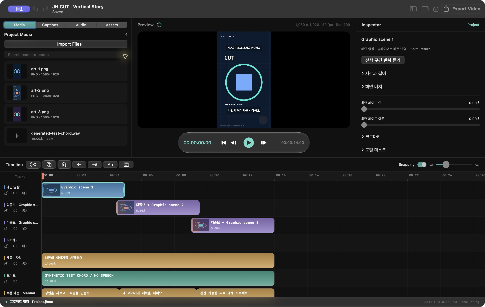

# JH CUT Studio 0.7

[English](README.md) · [공개 사이트](https://jhcut-studio.jonghyun04.chatgpt.site) · [편집 시작 샘플](https://github.com/jonghyun0000/JHCutStudio/releases/tag/samples-0.7.0-v2) · [출시 준비 상태](docs/RELEASE-READINESS.md) · [기여 안내](CONTRIBUTING.md)

Mac에서 계정·구독·자체 워터마크 없이 편집·저장·출력하는 로컬 영상 편집기입니다. 개발 버전은 **0.7.0, 빌드 8**이며 정식 Developer ID 서명·공증된 공개 설치 파일은 준비 중입니다. 상용 전문 편집기와 같은 완성도나 전체 요구 완료를 주장하지 않습니다.

## 실제 앱 화면




로컬 개발 앱0.7.0/빌드8의 실제 화면이며, 이후 자동 자막 영어 문구 65개 확장 전 캡처입니다. 영어는 부분 지원이고 고급 Inspector에는 한국어가 남아 있습니다. MIT 샘플의 생성 그래픽·수동 자막·테스트 화음이며 음성 인식 결과가 아닙니다. 정식 서명된 설치 파일이나 사용 녹화를 뜻하지 않습니다. [화면 출처와 원본 SHA](docs/images/README.md)를 확인하세요.

## 빌드와 실행

Apple Silicon과 최신 Apple 개발 도구가 필요합니다. 현재 문서화된 개발 환경은 CLT Swift 6.3.3, macOS SDK 26.5, Swift 5 언어 모드입니다. deployment target macOS 14는 모든 macOS 14 이상 환경의 지원 인수가 끝났다는 뜻이 아닙니다. 번들 Whisper runtime은 arm64입니다.

```bash
bash Scripts/build.sh
bash Scripts/run.sh
```

앱은 `Build/JH CUT Studio.app`에 만들어집니다. 소스를 변경했다면 build.sh를 다시 실행하세요. 로컬 ad-hoc 서명은 공증된 배포 서명과 다릅니다. [설치 안내](docs/INSTALL-0.7.md)에 모델·번역 언어팩·저장 공간 조건을 설명합니다.

## 첫 편집

한영 [첫 편집 가이드](docs/QUICKSTART.md)를 따라 시작할 수 있습니다. [공개 사이트](https://jhcut-studio.jonghyun04.chatgpt.site)에는 실제 앱 스크린샷 3장과 소스·[샘플 3종](https://github.com/jonghyun0000/JHCutStudio/releases/tag/samples-0.7.0-v2) 링크가 있습니다. 샘플 전용 prerelease는 MIT 고지를 포함한 생성 그래픽·수동 자막·수학적 테스트 화음이며 앱 설치 파일이나 음성 인식 정확도 데모가 아닙니다. 앱 설치 버튼은 비활성 상태이고 실제 사용 녹화는 아직 미완료입니다.

1. 지원 영상을 가져와 타임라인에 배치합니다. 모델이 없어도 수동 편집·저장·출력이 됩니다.
2. Space로 재생/일시정지, Cmd+B로 분할, Cmd+Z로 실행취소, Cmd+S로 저장합니다.
3. 자동 자막이 필요하면 출처·용량·라이선스·SHA-256을 확인하고 Whisper 모델 설치에 동의합니다. 음성인식은 Mac에서 처리합니다.
4. 한국어·일본어·영어 인식 결과의 문구·시간·언어를 직접 검수합니다. 번역에는 macOS 26 이상과 Apple 번역 언어팩이 필요합니다.
5. 음악·효과음·제목을 추가하고 `.jhcut` 저장/재열기 후 새 출력 파일을 만듭니다.

## 현재 범위

멀티트랙/연결 편집, 다중 선택, 리플/분할/트림, Undo/Redo, 프록시, 원본 기반 출력, 문서 백업/복구, 자막·원문/번역 연결, 6종 전환/블렌드, 도형 마스크와 선택 색 크로마키가 구현돼 있습니다. 한국어/영어 앱 언어 전환은 부분 범위이며 고급 도구·상세 오류에 한국어가 남아 있습니다. 개별 기능의 구현은 전체 사용자 인수나 모든 조건의 성능 보증이 아닙니다.

소재는 효과음112개·음악21곡·이미지225개입니다. 음악 중12곡은 기록 길이가2~3분입니다. [전체 credits](Resources/Library/CREDITS.md)와 각 소재 license를 함께 확인하세요.

## 지원 형식과 데이터 보호

입력은 실제 검사에서 허용된 SDR H.264/HEVC/ProRes 영상, PNG/JPEG/HEIC, 디코딩 가능한 오디오입니다. 지원되는 HDR은 명시적 SDR 변환 사본을 사용하며 알 수 없는 색 정보를 임의로 SDR로 붙이지 않습니다. 출력은 SDR Rec.709 H.264/HEVC MP4 또는 ProRes 422 MOV입니다. 현행 오디오는 AAC이며 ProRes도 PCM 출력 모드가 아닙니다. 실제 인코더·프로필 지원과 미검증 환경은 구분합니다.

원본 미디어를 편집 결과로 덮어쓰지 않습니다. 프로젝트를 옮길 때는 원본 수집 기능을 사용하세요. 핵심 편집/음성인식은 영상·음성·자막을 클라우드 API로 업로드하지 않습니다. 모델과 명시적으로 실행한 소재 수집 스크립트는 다운로드를 수행합니다.

## 기여와 검사

소스에 연결된 통합 runner에는 유효한 Git HEAD가 있는 독립 체크아웃(예: 검토한 리비전의 clone)이 필요합니다. source-review ZIP은 `Scripts/build.sh`로 빌드할 수 있지만 Git 이력이 없으므로 아래 통합 검사를 ZIP 안에서 바로 실행할 수 없습니다. 검증할 브랜치·커밋을 직접 선택하고, 상위의 무관한 저장소를 이 소스의 Git 식별자로 사용하지 마세요. GitHub에 소스가 있는 것과 정식 서명된 공개 다운로드의 인수 완료는 별개입니다.

```bash
python3 -B Scripts/verification-run.py --suites domain compatibility productivity ui-localization
```

domain에는 Xcode XCTest가 필요합니다. [공개 CI](.github/workflows/public-generated.yml)는 생성 fixture와 전체 앱 컴파일을 대상으로 합니다. 2026-10-16 KST(2026-10-15 UTC) [main hosted 검사](https://github.com/jonghyun0000/JHCutStudio/actions/runs/38773524663)는 `5f77ae1bb30021f7317bd5b32955fb72c9a4af28`의 전체 앱 빌드와 생성 검사 138개(domain 55, compatibility 46, productivity 37)를 통과했습니다. Python runner 10개와 workspace 검사 16개도 각각 별도로 통과했습니다. 진단 artifact에는 검증 index와 로그만 보존하며 출력·컴파일 바이너리는 포함하지 않습니다. [검증 범위와 한계](docs/RELEASE-READINESS.md#hosted-ci-evidence), [이후 Actions 결과](https://github.com/jonghyun0000/JHCutStudio/actions/workflows/public-generated.yml)를 확인하세요. 서명된 설치나 음성 인식 정확도를 입증한 결과는 아닙니다. 기본 전체 목록에는 비공개 실사 평가 입력/모델/언어팩이 필요한 검사가 포함됩니다. 개인 References와 결과 Artifacts는 이 공개 소스 후보에 포함하지 않습니다. private probe의 파일명은 로컬 평가 계약을 설명하며 임의 영상으로 대체해 같은 정확도 결과를 주장할 수 없습니다.

사람 정답이 없으므로 실제 음성 정확도 CER/WER와 번역 의미 품질은 점수화하지 않습니다. 자동 테스트 통과를 전체 완성도 점수로 환산하지 않습니다. [35개 요구와 고급 로드맵](docs/GOAL-REQUIREMENTS-2026-10-11.md), [중립 원본 명세](docs/ORIGINAL-PRODUCT-SPEC-2026-10-11.txt), [출시 준비 상태](docs/RELEASE-READINESS.md)를 유지합니다.

[MIT](LICENSE)와 [별도 고지](THIRD_PARTY_NOTICES.md), [기여 안내](CONTRIBUTING.md), [보안 제보](SECURITY.md)를 확인하세요. 소스 검토·빌드·게시·다른 Mac 설치 검증은 각각 별도 단계입니다. 실제 받은 리비전과 Release 상태를 확인하세요.
